<!-- gerado:banner -->
<picture>
  <source media="(prefers-color-scheme: dark)" srcset="assets/readme/banner-escuro.en.svg">
  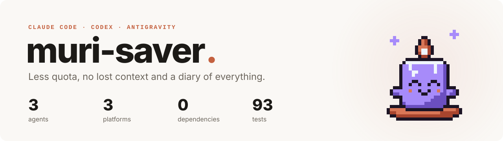
</picture>
<!-- /gerado:banner -->

<p align="center">
  <a href="README.md">Português</a> &nbsp;·&nbsp; <b>English</b>
</p>

<p align="center">
  <a href="#install">Install</a> &nbsp;·&nbsp;
  <a href="docs/architecture.md">Architecture</a> &nbsp;·&nbsp;
  <a href="docs/llm-chain.md">LLM chain</a> &nbsp;·&nbsp;
  <a href="docs/vault-live-notes.md">Live notes</a> &nbsp;·&nbsp;
  <a href="docs/reference.en.md">Reference</a> &nbsp;·&nbsp;
  <a href="CHANGELOG.md">Versions</a>
</p>

A governance, memory and logging kit for coding agents. It spends less quota, keeps context from evaporating between sessions and turns every session into a readable Obsidian note. It works with **Claude Code**, **Codex** and **Antigravity**, on macOS, Linux and Windows, with a Node installer and zero dependencies.

> [!NOTE]
> The numbers in this README come from the author's real usage and are a diagnosis, not a benchmark. Measure your own routine with `muri-saver report` and `muri-saver audit`. Vault screenshots use fake data from [`examples/vault/`](examples/vault/). Most deeper docs are in Portuguese.

## Why it exists

Anyone who uses a coding agent every day runs into three problems: the **quota runs out** and you can't tell why, **context evaporates** between sessions, and there's **no readable record** of what got done.

muri-saver came out of auditing real transcripts. One session alone burned 2.1 billion cache tokens in 42 hours; one file was re-read 54 times in the same session; browser automation took 501 screenshots where 3 text reads would do. Every rule in the kit answers one of those findings, and the rest runs on its own in hooks, so you don't have to remember.

## In 90 seconds

https://github.com/user-attachments/assets/c69dbadb-41bb-4152-825b-ace8e280813f

<sub>No narration, on-screen text in Portuguese. If the player doesn't load, <a href="https://github.com/user-attachments/assets/c69dbadb-41bb-4152-825b-ace8e280813f">open the video</a>. Terminal screens marked as simulations use the real scripts' colors, thresholds and text.</sub>

<table>
  <tr>
    <td width="33%">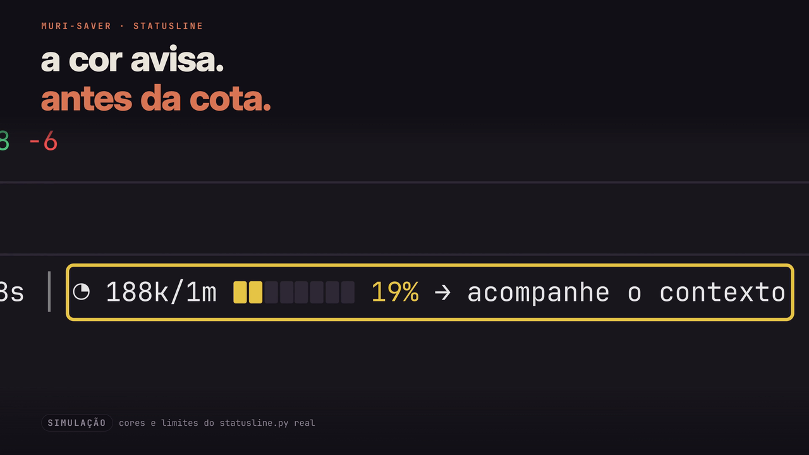<br><sub><b>Status line:</b> context, cache and quota at a glance</sub></td>
    <td width="33%">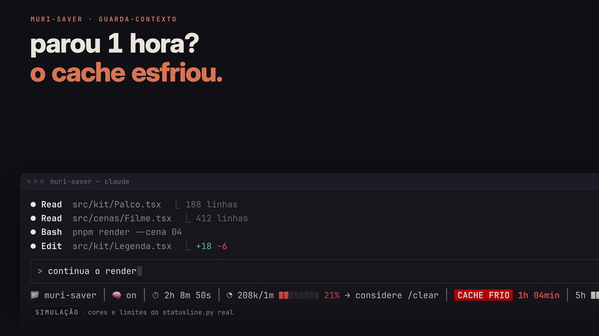<br><sub><b>Context guard:</b> stops the expensive resume</sub></td>
    <td width="33%">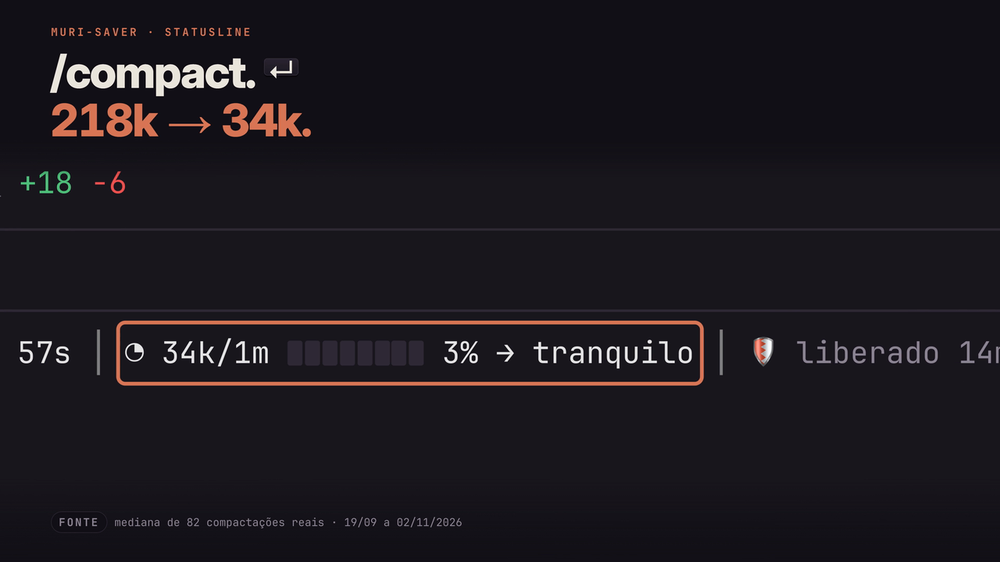<br><sub><b><code>/compact</code> at the right time:</b> 218k → 34k</sub></td>
  </tr>
  <tr>
    <td>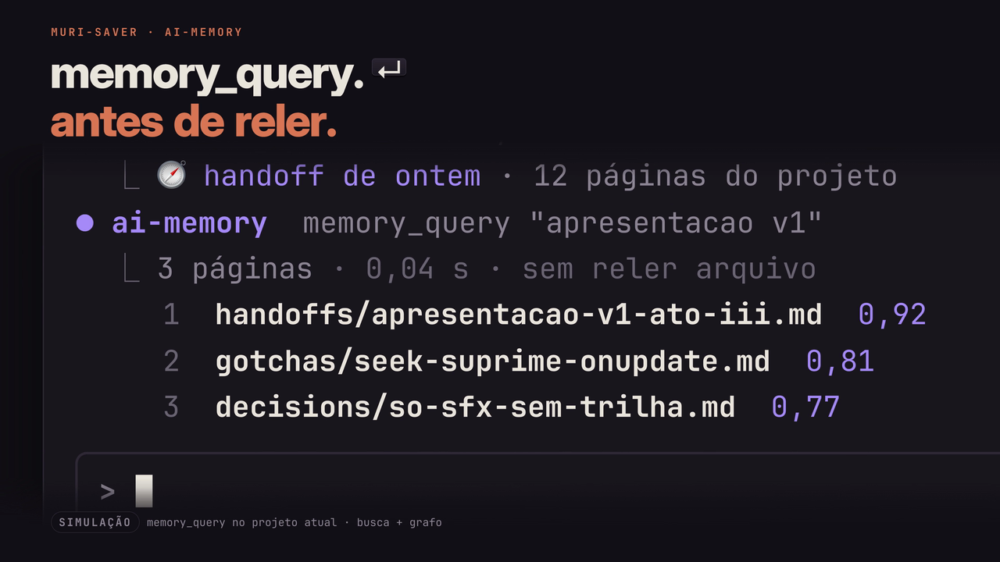<br><sub><b>Memory:</b> the next session knows where you stopped</sub></td>
    <td>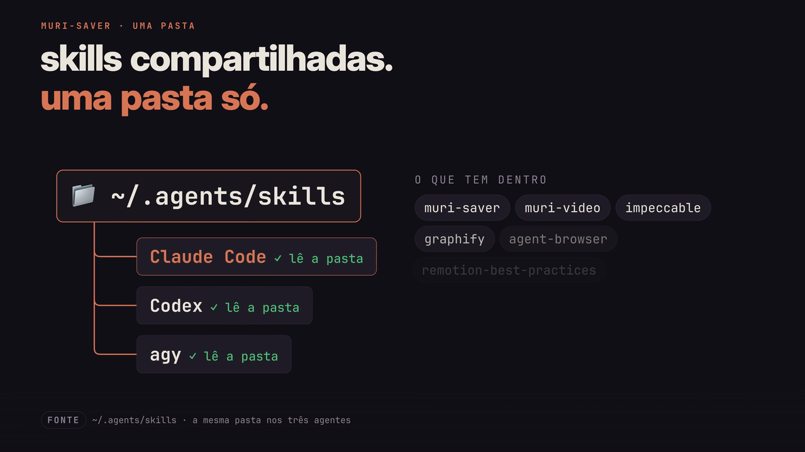<br><sub><b>Skills and connectors</b> on demand</sub></td>
    <td>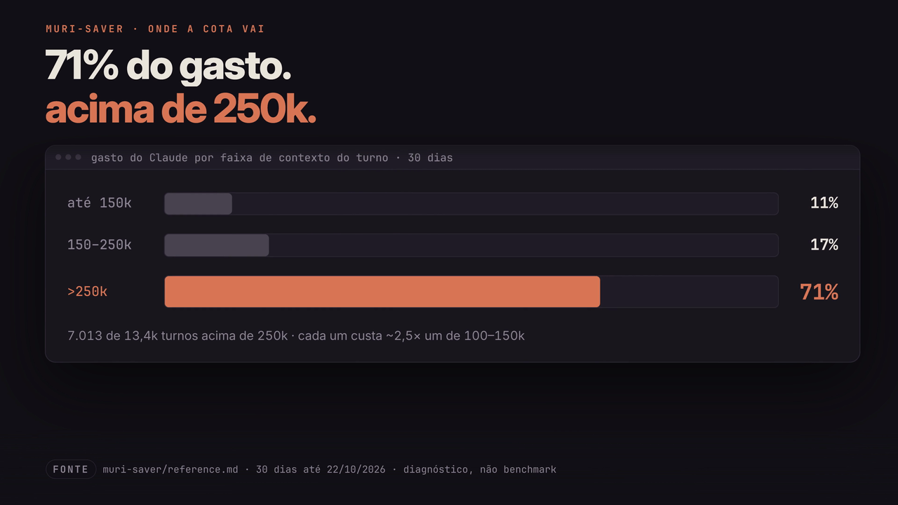<br><sub><b>Where the quota goes:</b> 71% above 250k</sub></td>
  </tr>
</table>

## What you see in the terminal

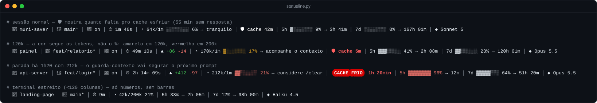

- **Status line:** context changes color by tokens (yellow at 120k, red at 200k), shows how long until the cache goes cold, and the 5-hour and 7-day quotas with a countdown.
- **Context guard:** after 55 minutes idle with more than 80k of context, it holds your next prompt once, because resuming would rewrite the whole cache. At 120k, 160k and 200k it reminds you to start a fresh session. `MURI_GUARDA=0` turns it off.
- **Notification:** a desktop alert when Claude is waiting for you (macOS and Linux). `MURI_NOTIFY=0` turns it off.
- **`muri-saver` skill:** say "muri saver" and the agent switches to aggressive saving: no re-reads, parallel calls, per-task profile and short sessions.

## What gets recorded

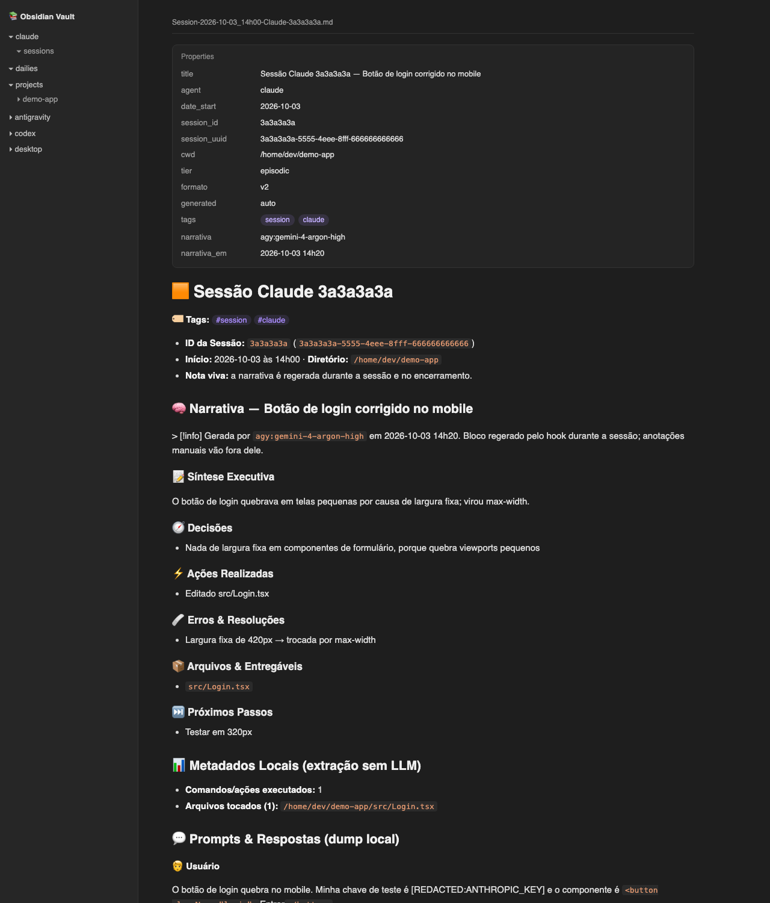

1. **Every turn** writes a local dump of the session to your vault, right away, without waiting for any model.
2. **Every 15 minutes**, a separate process writes the narrative: summary, decisions, actions and files.
3. **When the session ends**, the narrative gets its final version and lands in that day's Daily, next to the other agents' sessions.
4. **ai-memory** consolidates the session into searchable pages, and the next session starts knowing where you left off.
5. **Secrets are masked** before anything is written and before text reaches the model: a pasted key becomes `[REDACTED:ANTHROPIC_KEY]`.

Narratives and consolidation use a [model chain](docs/llm-chain.md) that switches on its own when one hits a limit. **No default uses your Claude quota.**

[Live notes in detail →](docs/vault-live-notes.md)

<br clear="right">

## Where the quota goes

<!-- gerado:cota -->
<picture>
  <source media="(prefers-color-scheme: dark)" srcset="assets/readme/cota-escuro.en.svg">
  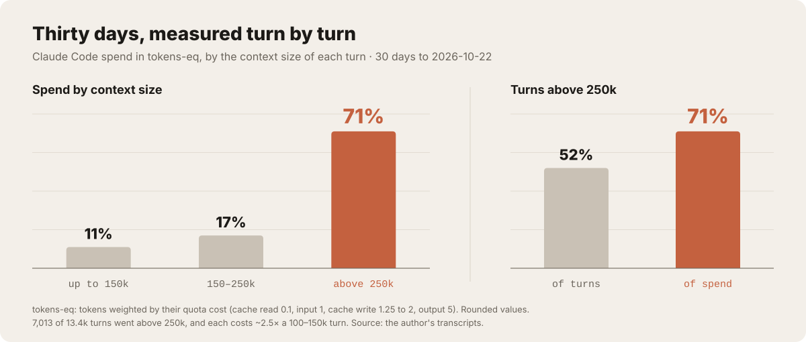
</picture>
<!-- /gerado:cota -->

Thirty days of usage measured turn by turn showed the problem isn't model choice, it's context size. Turns above 250k were half of all turns and **71% of spend**, because each one costs about 2.5 times a 100–150k turn. In the same analysis, 64 resumes on an already-cold cache cost 33.5 million tokens-eq, close to 11 points of the weekly quota over the month.

Hence the token-colored status line, the context guard and the 250k `autoCompactWindow` recommended in [`settings.snippet.json`](claude-config/settings.snippet.json).

## The findings

<!-- gerado:achados -->
<picture>
  <source media="(prefers-color-scheme: dark)" srcset="assets/readme/achados-escuro.en.svg">
  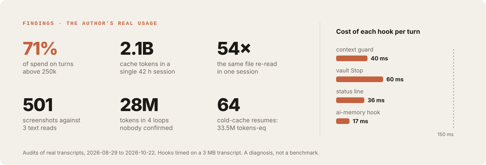
</picture>
<!-- /gerado:achados -->

Each number became a short rule in the governance: memory before re-reading, text before screenshots, confirmation before loops, a fresh session before a marathon.

> [!IMPORTANT]
> Hooks run on every turn, so they have to be cheap: **none takes more than 150 ms**. `Stop` never waits for a model; the narrative runs in a detached process.

## Install

```bash
git clone https://github.com/murilolol/muri-saver.git
cd muri-saver
node bin/install.mjs --dry-run      # shows what it would do, writes nothing
node bin/install.mjs --with-all     # Claude Code + Codex + Antigravity
node bin/doctor.mjs                 # checks everything, read-only
```

Without cloning: `npx github:murilolol/muri-saver install --with-all`. Then turn on what you want:

```bash
node bin/install.mjs --update --vault "/path/to/your/vault"   # every session becomes an Obsidian note
npx muri-saver llm chain && npx muri-saver llm tune            # ai-memory through the model chain
node bin/install.mjs --update --with-jobs                       # background jobs
```

Open a new session and say `muri-saver: review this project using less context`. [ai-memory](https://github.com/akitaonrails/ai-memory) is a separate program ([how to install](docs/ai-memory-obsidian-setup.md)); Obsidian is optional. Installing with an AI's help? Send it this repo's link and ask it to follow [`INSTALL-AI.md`](INSTALL-AI.md).

Existing settings are **merged**, never replaced; anything the installer overwrites gets a backup, and `--uninstall` removes only what you didn't edit. [Step by step →](INSTALL.md) &nbsp;·&nbsp; [All options →](docs/reference.en.md)

## What's included

| Piece | When it runs | What it solves |
|---|---|---|
| **Governance** (`CLAUDE.md`, `AGENTS.md`, `GEMINI.md`) | every session | Short rules: memory first, context vs quota, delegation, logs, git |
| **`muri-saver` skill** | on demand | Aggressive saving: no re-reads, parallel calls, short sessions |
| **Status line, guard and notification** | always (Claude Code) | Context, cache and quota in view; expensive resumes blocked |
| **Live Obsidian note** | every turn and at the end | Instant local dump and an LLM narrative in a separate process |
| **LLM chain** | narrative and ai-memory | Switches models on its own on limits or errors, outside your Claude quota |
| **Delegation** | when it pays off | Reading and research on Gemini, review and implementation on Codex, on their quota |
| **Background jobs** | OS scheduler | Idle sessions, ai-memory queue, backfill and weekly report; they stop on their own |
| **Report, audit and ingestor** | on demand | Where the quota went, repeated calls, and old history imported |

## How it works

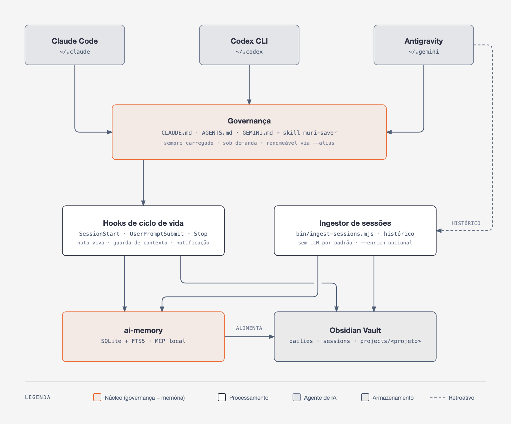

All three agents load the same governance. Lifecycle hooks (`SessionStart`, `UserPromptSubmit`, `Stop`, `SessionEnd`) feed ai-memory and the vault on every turn; the ingestor imports each agent's old history without spending a model call.

<details>
<summary>One session, step by step</summary>

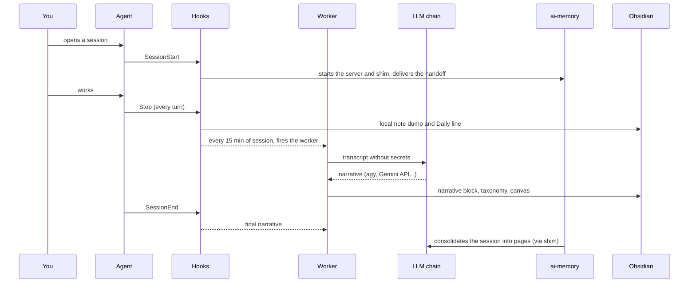

If the whole chain is in cooldown, the note keeps the dump and gets its narrative later: on the next interval, at `SessionEnd`, or from the backfill job.

</details>

[Architecture in detail →](docs/architecture.md)

## Versions

From a loose set of rules to the context guard. Each version is detailed in the [changelog](CHANGELOG.md) (in Portuguese).

| Version | Date | Milestone |
|---|---|---|
| [2.0.0](CHANGELOG.md#200) | 2026-09-25 | Configurable vault, timezone and alias; secret masking; `--update` and `--uninstall` |
| [2.1.0](CHANGELOG.md#210) | 2026-10-02 | Skills with a short core; templates from 59 KB to 8 KB; `audit` command |
| [3.1.0](CHANGELOG.md#310--2026-10-03) | 2026-10-03 | Live notes, LLM chain, background jobs on macOS, Linux and Windows, delegation |
| [3.2.0](CHANGELOG.md#320--2026-11-01) | 2026-11-01 | Context guard, new status line, notification and process reaper |

## Technology

<p>
  
</p>

Node.js 18 or newer, standard library only, plus helper scripts in Python and shell. Memory lives in [ai-memory](https://github.com/akitaonrails/ai-memory) (SQLite with FTS5 search and a local MCP server). Jobs run on launchd, `systemd --user` or crontab, and Windows Task Scheduler. 93 tests with `node:test`, running in a temporary home with fake binaries: no test touches your config or calls a model.

## Documentation

| Page | What's in it |
|---|---|
| [Installation](INSTALL.md) · [for AI](INSTALL-AI.md) | Step by step, for humans and for agents |
| [Reference](docs/reference.en.md) | Installer options, commands, configuration, jobs, cross-platform |
| [Architecture](docs/architecture.md) | How the pieces fit together |
| [LLM chain](docs/llm-chain.md) | Models, shim, key and ai-memory limits |
| [Live notes](docs/vault-live-notes.md) | One note per session, taxonomy, bridge to ai-memory |
| [Background jobs](docs/background-jobs.md) | Jobs per OS, how they stop, logs |
| [Delegation](docs/delegation.md) | Gemini and Codex on their own quota |
| [Economy report](docs/economy-report.md) · [Audit](docs/audit.en.md) | Where the quota went, tokens-eq |
| [ai-memory and Obsidian](docs/ai-memory-obsidian-setup.md) · [Ingestor](docs/session-ingestor.md) | Memory, MCP and old history |
| [Companion skills](docs/skills-companion.md) · [Troubleshooting](docs/troubleshooting.md) | Third-party skills that pair well, and fixes |

## Contributing and credits

Contributions are welcome: see [`CONTRIBUTING.md`](CONTRIBUTING.md) and the [issues](https://github.com/murilolol/muri-saver/issues). MIT license ([`LICENSE`](LICENSE)). Made by [@murilolol](https://github.com/murilolol) from real daily use; `muri-saver` and `grill-me` are original content. [ai-memory](https://github.com/akitaonrails/ai-memory) is by [Fabio Akita](https://github.com/akitaonrails), and the companion skills belong to their authors.

<sub>The banner, the chart and the findings card are generated from <a href="assets/readme/dados.json">assets/readme/dados.json</a> by <a href="tools/build-readme.mjs">tools/build-readme.mjs</a>. The mascot is Pavio, from the presentation video. If this saved you quota or an afternoon of lost context, a ⭐ helps someone else find it.</sub>
