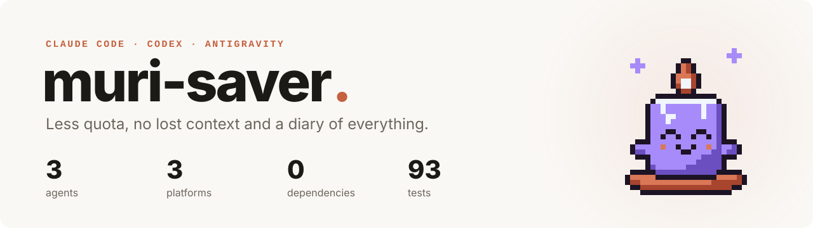
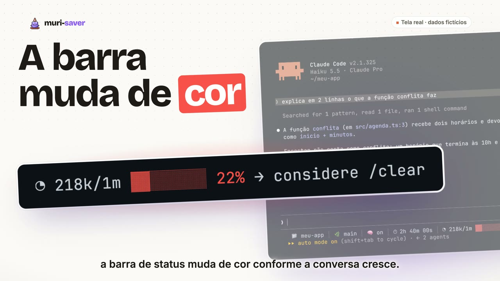
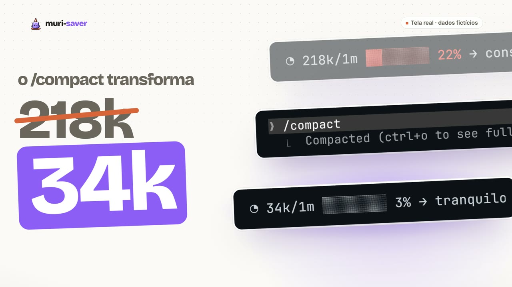
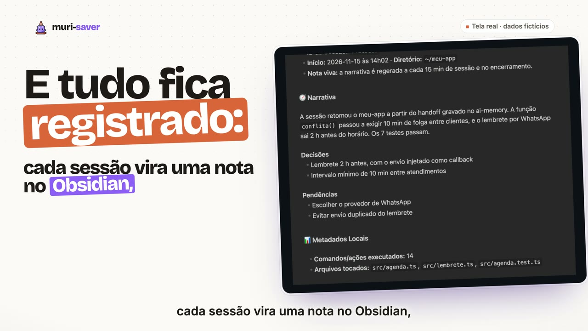
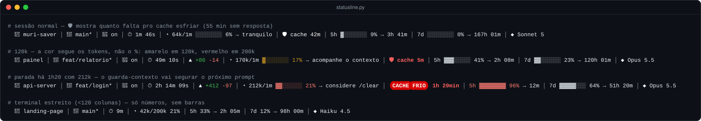
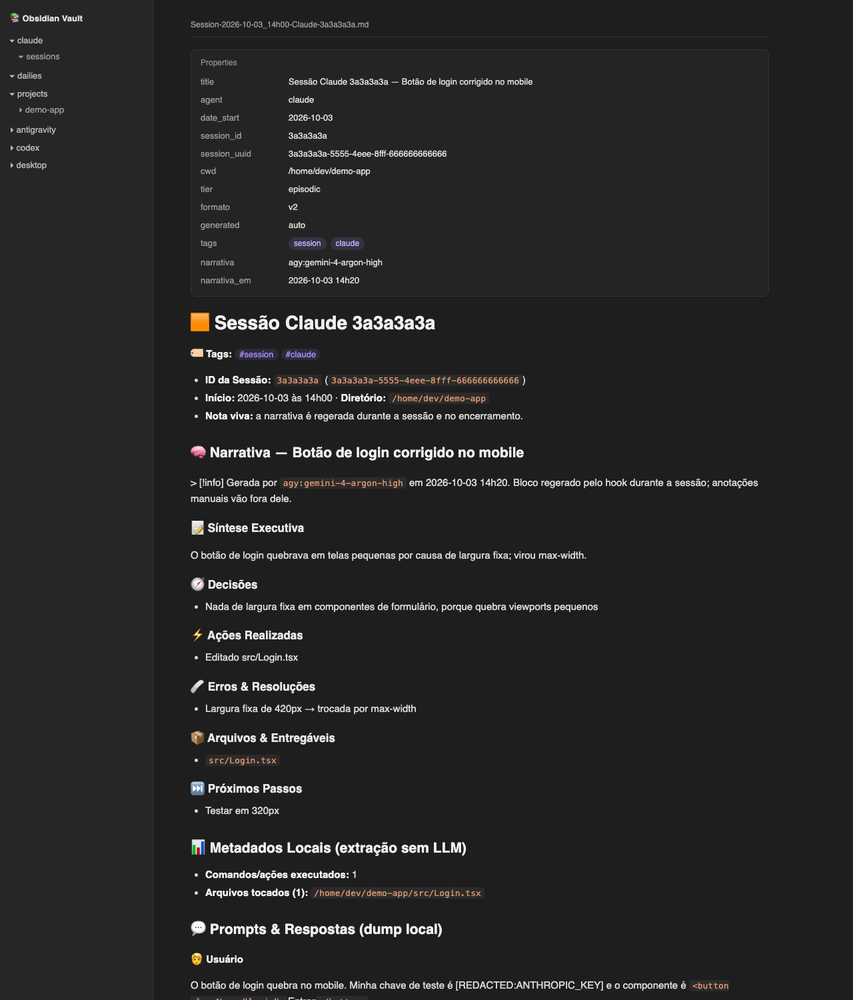
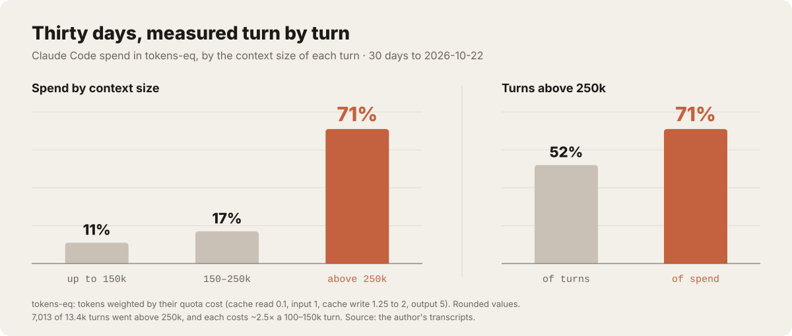
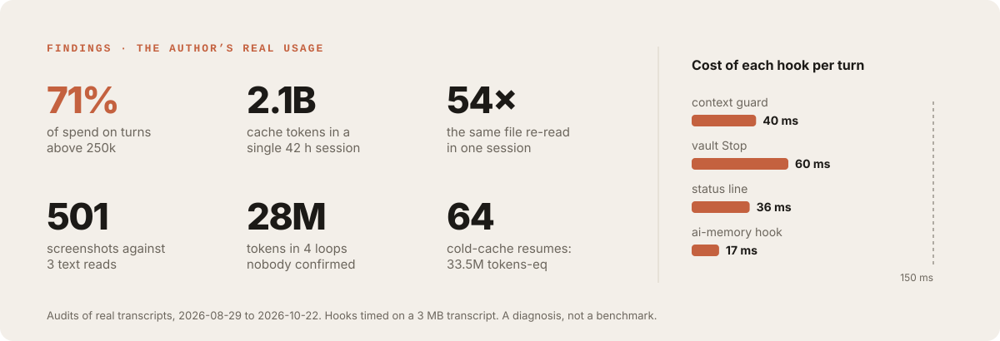
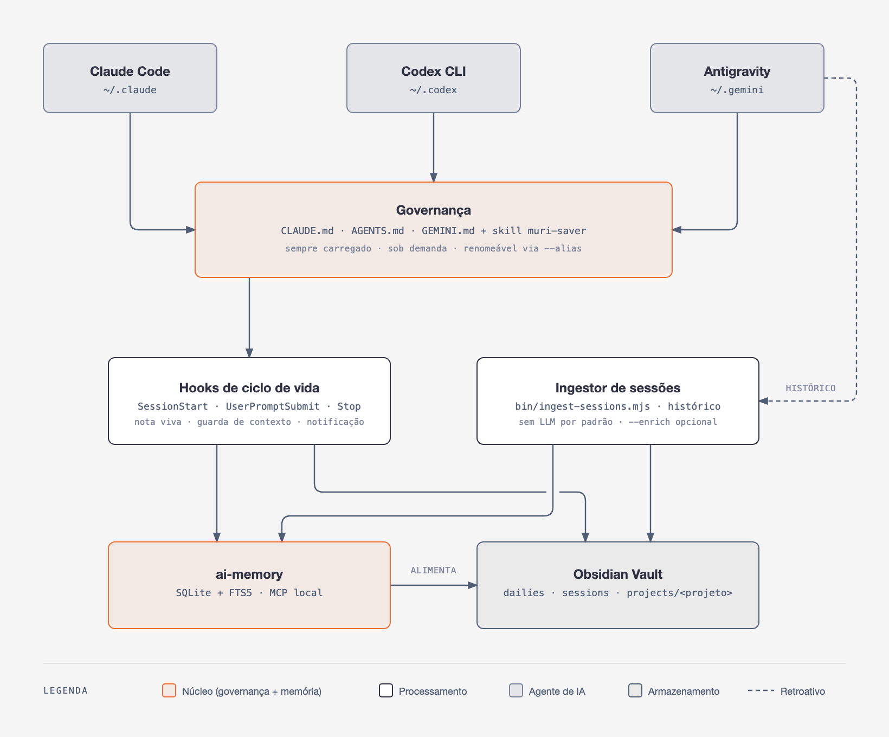
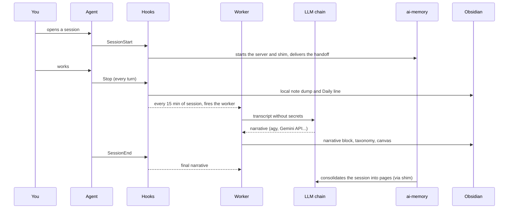

<!-- gerado:banner -->
<picture>
  <source media="(prefers-color-scheme: dark)" srcset="assets/readme/banner-escuro.en.svg">
  
</picture>
<!-- /gerado:banner -->

<p align="center">
  <a href="README.md">Português</a> &nbsp;·&nbsp; <b>English</b>
</p>

<p align="center">
  <a href="#install">Install</a> &nbsp;·&nbsp;
  <a href="docs/architecture.md">Architecture</a> &nbsp;·&nbsp;
  <a href="docs/llm-chain.md">LLM chain</a> &nbsp;·&nbsp;
  <a href="docs/vault-live-notes.md">Live notes</a> &nbsp;·&nbsp;
  <a href="docs/reference.en.md">Reference</a> &nbsp;·&nbsp;
  <a href="CHANGELOG.md">Versions</a>
</p>

A governance, memory and logging kit for coding agents. It spends less quota, keeps context from evaporating between sessions and turns every session into a readable Obsidian note. It works with **Claude Code**, **Codex** and **Antigravity**, on macOS, Linux and Windows, with a Node installer and zero dependencies.

**Install in 1 minute.** Needs Node 18+ and Python 3; ai-memory and Obsidian are optional; 0 npm dependencies.

```bash
git clone https://github.com/murilolol/muri-saver.git && cd muri-saver
node bin/install.mjs --dry-run      # shows what it would do, writes nothing
```

Options and next steps under [Install](#install).

> [!NOTE]
> The numbers in this README come from the author's real usage and are a diagnosis, not a benchmark. Measure your own routine with `node bin/cli.mjs report` and `node bin/cli.mjs audit`. Vault screenshots use fake data from [`examples/vault/`](examples/vault/). Most deeper docs are in Portuguese.

## Why it exists

Anyone who uses a coding agent every day runs into three problems: the **quota runs out** and you can't tell why, **context evaporates** between sessions, and there's **no readable record** of what got done.

muri-saver came out of auditing real transcripts. One session alone burned 2.1 billion cache tokens in 42 hours; one file was re-read 54 times in the same session; browser automation took 501 screenshots where 3 text reads would do. Every rule in the kit answers one of those findings, and the rest runs on its own in hooks, so you don't have to remember.

## In 77 seconds
<a id="in-90-seconds"></a>

https://github.com/user-attachments/assets/2539e5ed-4393-4391-82ba-e5e1eb926f9a

<sub><b>Turn the sound on:</b> the video is narrated in Portuguese and GitHub's player starts muted. If it doesn't load, <a href="https://github.com/user-attachments/assets/2539e5ed-4393-4391-82ba-e5e1eb926f9a">open the video</a>. Real terminal screens on a fictional project; numbers come from the author's real usage (<a href="assets/readme/dados.json">source</a>).</sub>

<details>
<summary>English transcript</summary>

Does Claude hit its limit too fast? It's not that you ask too much. It's the conversation swelling without you noticing.

I measured thirty days of my own usage. One session lasted 42 hours. One file was re-read 54 times. And 71% of the spend came from giant conversations.

That's why I built muri-saver: a kit that makes Claude Code lighter, cheaper and gives it memory.

First, it shows you the problem: the status bar changes color as the conversation grows. Back after an hour? The context guard warns you before you pay for it. And `/compact` turns 200k tokens into 30k.

But trimming can't erase what matters. ai-memory records each session's decisions, and the next one picks up where the last one stopped. No re-explaining.

Claude becomes the coordinator. Research, reading and review go to Gemini and Codex, on their own quota. Your limit is saved for what only Claude does well.

And everything gets recorded: every session becomes an Obsidian note, and the diary writes itself.

Fewer tokens, less cost, and a Claude that remembers. muri-saver is free and open source. Link on screen. Follow me: @muriloodev.

</details>

<table>
  <tr>
    <td width="33%"><br><sub><b>Status line:</b> changes color as the conversation grows</sub></td>
    <td width="33%"><br><sub><b>Context guard:</b> stops the expensive resume</sub></td>
    <td width="33%"><br><sub><b><code>/compact</code> at the right time:</b> 218k → 34k</sub></td>
  </tr>
  <tr>
    <td><br><sub><b>Memory:</b> the next session knows where you stopped</sub></td>
    <td><br><sub><b>Delegation:</b> research, reading and review on Gemini and Codex</sub></td>
    <td><br><sub><b>Live note:</b> every session becomes an Obsidian note</sub></td>
  </tr>
</table>

## What you see in the terminal



- **Status line:** context is shown against the point where Claude Code compacts (`autoCompactWindow` or the model's window) and changes color at 70% and 90% of it; it shows how long until the cache goes cold (1 h or 5 min TTL, read from the transcript) and the 5-hour and 7-day quotas with a countdown. The 5-hour one hides on plans without that window.
- **Context guard:** after 55 minutes idle with more than 40% of the compaction point, it holds your next prompt once, because resuming would rewrite the whole cache (with a 5-minute TTL it only warns). At 70% and 90% of that point it reminds you to start a fresh session, and it warns when the weekly quota passes 70% and 90%. `MURI_GUARDA=0` turns it off.
- **Notification:** a desktop alert when Claude is waiting for you (macOS and Linux). `MURI_NOTIFY=0` turns it off.
- **`muri-saver` skill:** say "muri saver" and the agent switches to aggressive saving: no re-reads, parallel calls, per-task profile and short sessions.

## What gets recorded



1. **Every turn** writes a local dump of the session to your vault, right away, without waiting for any model.
2. **Every 15 minutes**, a separate process writes the narrative: summary, decisions, actions and files.
3. **When the session ends**, the narrative gets its final version and lands in that day's Daily, next to the other agents' sessions.
4. **ai-memory** consolidates the session into searchable pages, and the next session starts knowing where you left off.
5. **Secrets are masked** before anything is written and before text reaches the model: a pasted key becomes `[REDACTED:ANTHROPIC_KEY]`.

Narratives and consolidation use a [model chain](docs/llm-chain.md) that switches on its own when one hits a limit. **No default uses your Claude quota.**

[Live notes in detail →](docs/vault-live-notes.md)

<br clear="right">

## Where the quota goes

<!-- gerado:cota -->
<picture>
  <source media="(prefers-color-scheme: dark)" srcset="assets/readme/cota-escuro.en.svg">
  
</picture>
<!-- /gerado:cota -->

Thirty days of usage measured turn by turn showed the problem isn't model choice, it's context size. Turns above 250k were half of all turns and **71% of spend**, because each one costs about 2.5 times a 100–150k turn. In the same analysis, 64 resumes on an already-cold cache cost 33.5 million tokens-eq. How many points of the weekly quota that makes depends on the plan, and the analysis ran on a smaller plan; the calibration in the [economy report](docs/economy-report.md) does that math on yours.

Hence the status line that measures context against the compaction point, the context guard and the `autoCompactWindow` of each plan profile (below).

## Claude plan and context

**The window comes from the model, not the plan.** The newest models run with 1M context on any paid plan; others have 500K or 200K. The point where Claude Code compacts comes from the `autoCompactWindow` in your `settings.json` (without it, around 967k on a 1M model). **The plan sets the quota:**

| Plan | 5-hour quota | Weekly quota |
|---|---|---|
| Pro | 1x | 1x |
| Max (formerly Max 5x) | 5x Pro | 5x Pro |
| Ultra (formerly Max 20x) | none, on a verified account | 10x Pro |
| Team | 1.25x (Standard) or 6.25x (Premium) Pro | per member |
| Enterprise and API | usage paid per token | — |

The names changed on 2026-10-30: Max 5x became Max and Max 20x became Ultra.

**What the profile adjusts:** a single number, the `autoCompactWindow` (Pro 250k, Max 400k, Ultra 500k, Team 250k, Enterprise 300k, API 250k; the values live in [`hooks/plan-profiles.json`](hooks/plan-profiles.json)). The guard's reminders and the status line colors sit at 70% and 90% of the compaction point on every profile. The installer detects the plan (`claude auth status`) and saves it in `muri-saver.json`; the value only goes into `settings.json` with `--apply-compact`, and never over one of yours. `doctor` shows the saved and the detected profile.

```bash
node bin/install.mjs --update --plan pro --apply-compact
```

Only 250k has a measured basis: it came from the 30-day analysis above, run on a smaller plan. The other values are guesses until measured (`node bin/cli.mjs report` for a week or two on each plan). A turn above 250k costs about 2.5 times a 100–150k turn on any plan; a bigger plan only gives you more quota to spend.

## The findings

<!-- gerado:achados -->
<picture>
  <source media="(prefers-color-scheme: dark)" srcset="assets/readme/achados-escuro.en.svg">
  
</picture>
<!-- /gerado:achados -->

Each number became a short rule in the governance: memory before re-reading, text before screenshots, confirmation before loops, a fresh session before a marathon.

> [!IMPORTANT]
> Hooks run on every turn, so they have to be cheap: **none takes more than 150 ms**. `Stop` never waits for a model; the narrative runs in a detached process.

## Install

```bash
git clone https://github.com/murilolol/muri-saver.git
cd muri-saver
node bin/install.mjs --dry-run      # shows what it would do, writes nothing
node bin/install.mjs --with-all     # Claude Code + Codex + Antigravity
node bin/doctor.mjs                 # checks everything, read-only
```

Without cloning: `npx github:murilolol/muri-saver install --with-all` (in the commands below, swap `node bin/install.mjs` for `npx github:murilolol/muri-saver install` and `node bin/cli.mjs` for `npx github:murilolol/muri-saver`). Then turn on what you want:

```bash
node bin/install.mjs --update --vault "/path/to/your/vault"   # every session becomes an Obsidian note
node bin/cli.mjs llm chain && node bin/cli.mjs llm tune        # ai-memory through the model chain
node bin/install.mjs --update --with-jobs                       # background jobs
```

Open a new session and say `muri-saver: review this project using less context`. [ai-memory](https://github.com/akitaonrails/ai-memory) is a separate program ([how to install](docs/ai-memory-obsidian-setup.md)); Obsidian is optional. Installing with an AI's help? Send it this repo's link and ask it to follow [`INSTALL-AI.md`](INSTALL-AI.md).

Existing settings are **merged**, never replaced; anything the installer overwrites gets a backup, and `--uninstall` removes only what you didn't edit. [Step by step →](INSTALL.md) &nbsp;·&nbsp; [All options →](docs/reference.en.md)

## What's included

| Piece | When it runs | What it solves |
|---|---|---|
| **Governance** (`CLAUDE.md`, `AGENTS.md`, `GEMINI.md`) | every session | Short rules: memory first, context vs quota, delegation, logs, git |
| **`muri-saver` skill** | on demand | Aggressive saving: no re-reads, parallel calls, short sessions |
| **Status line, guard and notification** | always (Claude Code) | Context, cache and quota in view; expensive resumes blocked |
| **Live Obsidian note** | every turn and at the end | Instant local dump and an LLM narrative in a separate process |
| **LLM chain** | narrative and ai-memory | Switches models on its own on limits or errors, outside your Claude quota |
| **Delegation** | when it pays off | Reading and research on Gemini, review and implementation on Codex, on their quota |
| **Background jobs** | OS scheduler | Idle sessions, ai-memory queue, backfill and weekly report; they stop on their own |
| **Report, audit and ingestor** | on demand | Where the quota went, repeated calls, and old history imported |

## How it works



All three agents load the same governance. Lifecycle hooks (`SessionStart`, `UserPromptSubmit`, `Stop`, `SessionEnd`) feed ai-memory and the vault on every turn; the ingestor imports each agent's old history without spending a model call.

<details>
<summary>One session, step by step</summary>



If the whole chain is in cooldown, the note keeps the dump and gets its narrative later: on the next interval, at `SessionEnd`, or from the backfill job.

</details>

[Architecture in detail →](docs/architecture.md)

## Skills I use alongside it

muri-saver ships two skills of its own, `muri-saver` and `grill-me`. The rest are third-party: install each one straight from its source (`find-skills` helps) so you get the author's updates. In Claude Code, I turn off what I don't use with `skillOverrides` in `settings.json`, so the skill list doesn't weigh on the context ([how](docs/skills-companion.md#podar-o-que-você-não-usa-skilloverrides)). My video skill and this stack, with credit to each author, live in [murilolol/muri-skills](https://github.com/murilolol/muri-skills).

The curated list of companion skills, with install commands, credits and the `prototype` name clash, is in [`docs/skills-companion.md`](docs/skills-companion.md); `--with-companion-skills` installs four of them (`find-skills`, `tdd`, `prototype` and `grill-with-docs`).

### Orchestration, savings and memory

| Skill | Source | What for |
|---|---|---|
| `muri-saver` | this repository | Context and quota saving mode: one short session per topic, no re-reads, text before screenshots, delegation to another quota |
| `grill-me` | this repository | An interview through the native question modal (AskUserQuestion) before deciding |
| ai-memory (MCP server + hooks, not a skill) | [akitaonrails/ai-memory](https://github.com/akitaonrails/ai-memory) | Memory across sessions, search and handoff |
| `find-skills` | [vercel-labs/skills](https://github.com/vercel-labs/skills) | Finds and installs skills through `npx skills` |
| `ponytail` (plugin) | [DietrichGebert/ponytail](https://github.com/DietrichGebert/ponytail) | The smallest change that solves it: YAGNI, stdlib first, no abstraction nobody asked for |
| `codex` (Claude Code plugin) | [openai/codex-plugin-cc](https://github.com/openai/codex-plugin-cc) | Uses Codex from inside Claude Code for review and delegation |

### Planning and code

| Skill | Source | What for |
|---|---|---|
| `tdd`, `grill-with-docs`, `codebase-design` | [mattpocock/skills](https://github.com/mattpocock/skills) | TDD, an interview that becomes an ADR and a glossary, code design |
| `test-driven-development` | [obra/superpowers](https://github.com/obra/superpowers) | The discipline of testing before implementing |
| `graphify` | [Graphify-Labs/graphify](https://github.com/Graphify-Labs/graphify) | A knowledge graph of the code (query, path, explain) |
| OpenSpec | [Fission-AI/OpenSpec](https://github.com/Fission-AI/OpenSpec) | A spec before a big change |
| `agent-browser` | [vercel-labs/agent-browser](https://github.com/vercel-labs/agent-browser) | Browser automation for QA |

### Design and UI

| Skill | Source | What for |
|---|---|---|
| `impeccable` | [pbakaus/impeccable](https://github.com/pbakaus/impeccable) | Design, critique and polish interfaces |
| `emil-design-eng`, `animate` | [emilkowalski/skills](https://github.com/emilkowalski/skills) | UI polish and motion decisions |
| `design-taste-frontend` | [Leonxlnx/taste-skill](https://github.com/Leonxlnx/taste-skill) | Front-end that doesn't look templated |
| `frontend-design` | [anthropics/skills](https://github.com/anthropics/skills) | Intentional visual direction |
| `web-design-guidelines` | [vercel-labs/agent-skills](https://github.com/vercel-labs/agent-skills) | Review against the Web Interface Guidelines |
| `diagram-design` (plugin) | [cathrynlavery/diagram-design](https://github.com/cathrynlavery/diagram-design) | Editorial diagrams in HTML, SVG and PNG |

### Video

| Skill | Source | What for |
|---|---|---|
| `muri-video` | [murilolol/muri-skills](https://github.com/murilolol/muri-skills) | Narrated video pipeline: briefing, script, TTS, Remotion, 16:9 and 9:16 render. The video above came out of it |
| `remotion-best-practices` | [remotion-dev/skills](https://github.com/remotion-dev/skills) | Remotion best practices |
| HyperFrames (Codex plugin) | [heygen-com/hyperframes](https://github.com/heygen-com/hyperframes) | Video written in HTML + GSAP |
| `video-shotcraft` | [Vincentwei1021/video-shotcraft](https://github.com/Vincentwei1021/video-shotcraft) | Product video from shot recipe cards |
| `gsap-*` | [greensock/gsap-skills](https://github.com/greensock/gsap-skills) | Animation with GSAP |
| `image-to-video` | [prime-skills/runcomfy-agent-skills](https://github.com/prime-skills/runcomfy-agent-skills) | Animates a still image (RunComfy) |

### Documents and notes

| Skill | Source | What for |
|---|---|---|
| `pdf`, `docx`, `pptx`, `xlsx` | [anthropics/skills](https://github.com/anthropics/skills) | Read and create office documents |
| `convert-documents-to-markdown` | [firecrawl/anydoc](https://github.com/firecrawl/anydoc) | Converts Office, PDF and EPUB to Markdown |
| `obsidian` (plugin) | [obsidianmd/obsidian-skills](https://github.com/obsidianmd/obsidian-skills) | Vault files: Markdown, Bases and Canvas |
| `claude-obsidian` (plugin) | [AgriciDaniel/claude-obsidian](https://github.com/AgriciDaniel/claude-obsidian) | A local knowledge base in Obsidian with cited sources |

## Versions

From a loose set of rules to the context guard. Each version is detailed in the [changelog](CHANGELOG.md) (in Portuguese).

| Version | Date | Milestone |
|---|---|---|
| [2.0.0](CHANGELOG.md#200) | 2026-09-25 | Configurable vault, timezone and alias; secret masking; `--update` and `--uninstall` |
| [2.1.0](CHANGELOG.md#210) | 2026-10-02 | Skills with a short core; templates from 59 KB to 8 KB; `audit` command |
| [3.1.0](CHANGELOG.md#310--2026-10-03) | 2026-10-03 | Live notes, LLM chain, background jobs on macOS, Linux and Windows, delegation |
| [3.2.0](CHANGELOG.md#320--2026-11-01) | 2026-11-01 | Context guard, new status line, notification and process reaper |

## Technology

<p>
  
</p>

Node.js 18 or newer, standard library only, plus helper scripts in Python and shell. Memory lives in [ai-memory](https://github.com/akitaonrails/ai-memory) (SQLite with FTS5 search and a local MCP server). Jobs run on launchd, `systemd --user` or crontab, and Windows Task Scheduler. 93 tests with `node:test`, running in a temporary home with fake binaries: no test touches your config or calls a model.

## Documentation

| Page | What's in it |
|---|---|
| [Installation](INSTALL.md) · [for AI](INSTALL-AI.md) | Step by step, for humans and for agents |
| [Reference](docs/reference.en.md) | Installer options, commands, configuration, jobs, cross-platform |
| [Architecture](docs/architecture.md) | How the pieces fit together |
| [LLM chain](docs/llm-chain.md) | Models, shim, key and ai-memory limits |
| [Live notes](docs/vault-live-notes.md) | One note per session, taxonomy, bridge to ai-memory |
| [Background jobs](docs/background-jobs.md) | Jobs per OS, how they stop, logs |
| [Delegation](docs/delegation.md) | Gemini and Codex on their own quota |
| [Economy report](docs/economy-report.md) · [Audit](docs/audit.en.md) | Where the quota went, tokens-eq |
| [ai-memory and Obsidian](docs/ai-memory-obsidian-setup.md) · [Ingestor](docs/session-ingestor.md) | Memory, MCP and old history |
| [Companion skills](docs/skills-companion.md) · [Troubleshooting](docs/troubleshooting.md) | Third-party skills that pair well, and fixes |
| [Evaluate the skill](docs/evaluation.md) · [ZIP packages](docs/marketplace.md) | Scenarios to compare skill versions; skill ZIPs for marketplaces |

## Contributing and credits

Contributions are welcome: see [`CONTRIBUTING.md`](CONTRIBUTING.md) and the [issues](https://github.com/murilolol/muri-saver/issues). MIT license ([`LICENSE`](LICENSE)). Made by [@murilolol](https://github.com/murilolol) from real daily use; `muri-saver` and `grill-me` are original content. [ai-memory](https://github.com/akitaonrails/ai-memory) is by [Fabio Akita](https://github.com/akitaonrails), and the companion skills belong to their authors.

<sub>The banner, the chart and the findings card are generated from <a href="assets/readme/dados.json">assets/readme/dados.json</a> by <a href="tools/build-readme.mjs">tools/build-readme.mjs</a>. The mascot is Pavio, from the presentation video. If this saved you quota or an afternoon of lost context, a ⭐ helps someone else find it.</sub>
