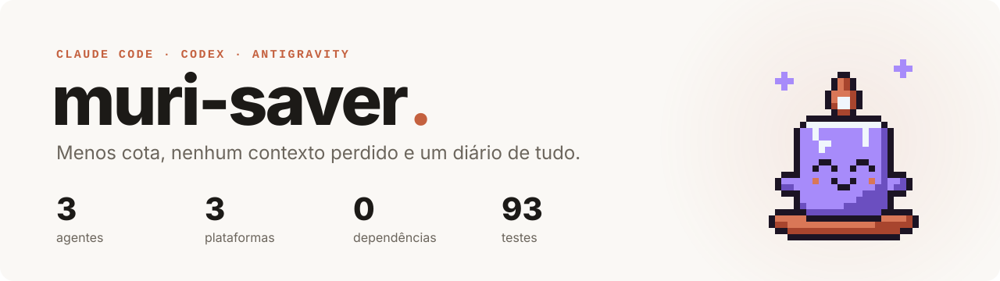
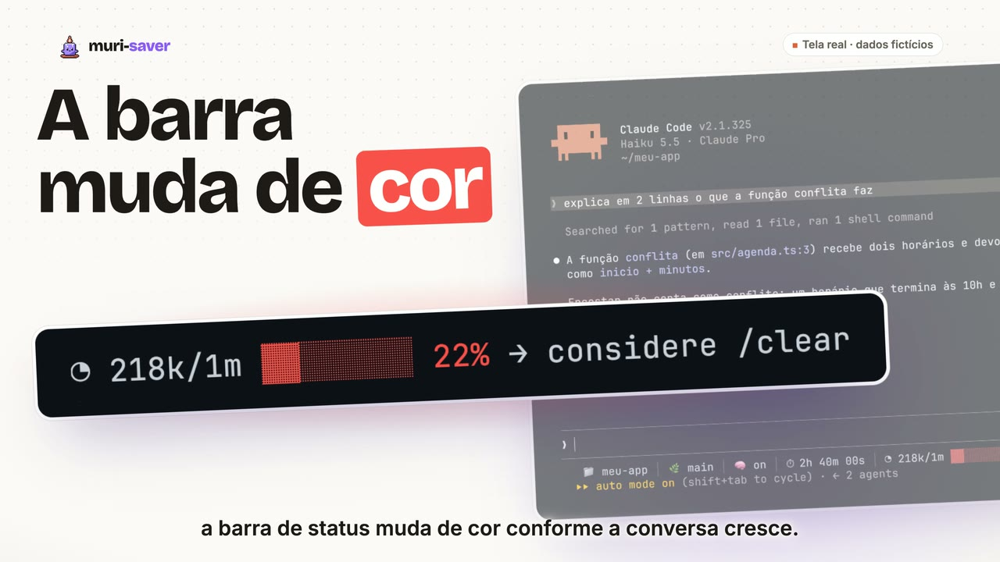
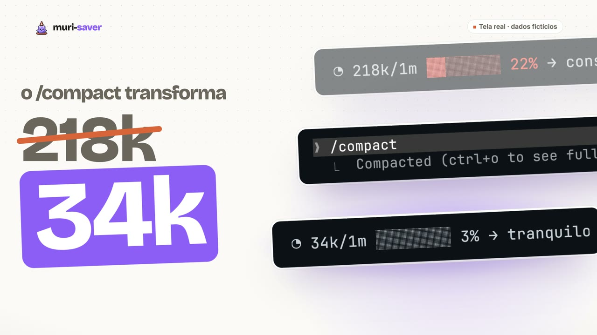
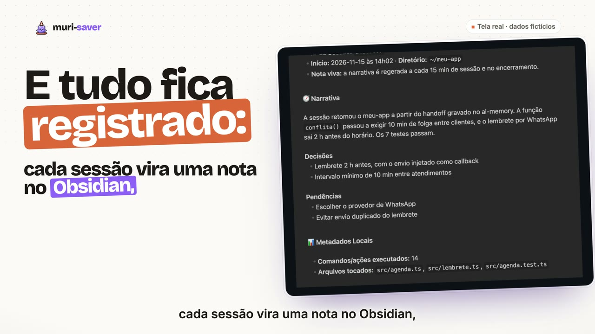
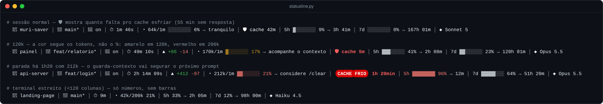
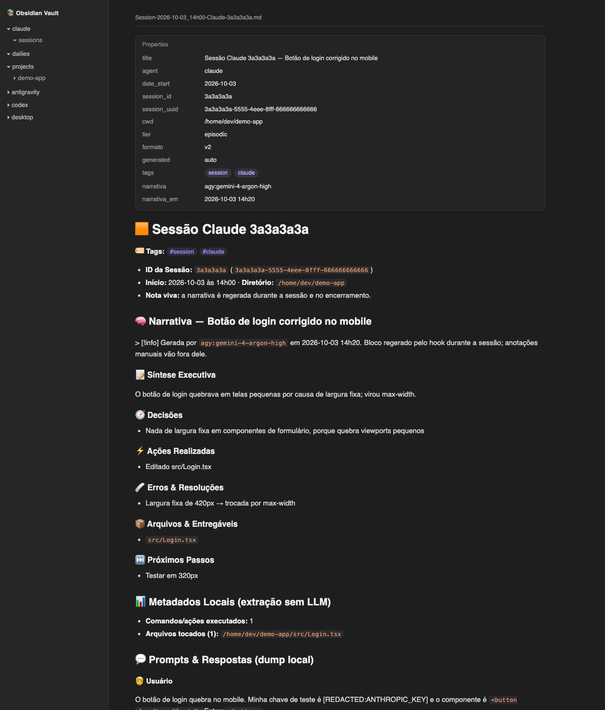
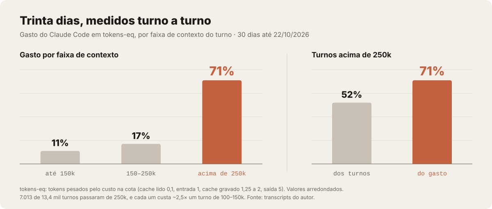
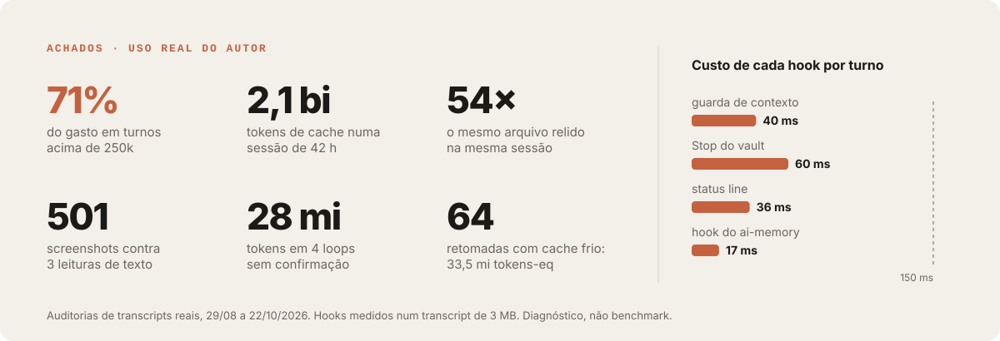
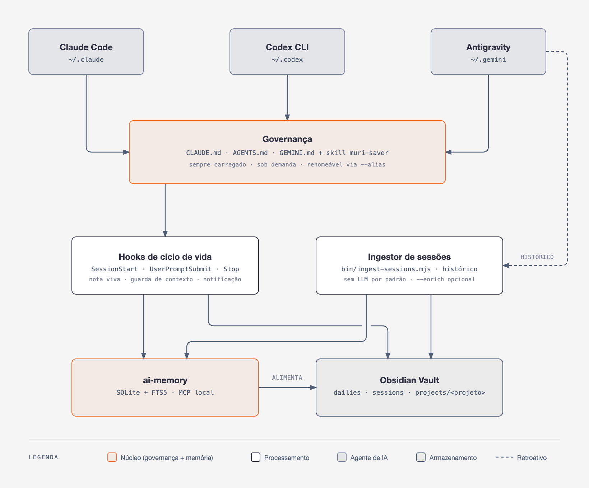
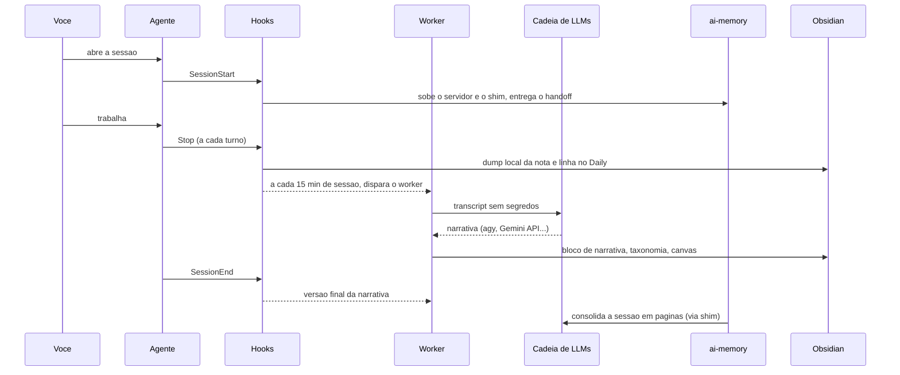

<!-- gerado:banner -->
<picture>
  <source media="(prefers-color-scheme: dark)" srcset="assets/readme/banner-escuro.svg">
  
</picture>
<!-- /gerado:banner -->

<p align="center">
  <b>Português</b> &nbsp;·&nbsp; <a href="README.en.md">English</a>
</p>

<p align="center">
  <a href="#instalar">Instalar</a> &nbsp;·&nbsp;
  <a href="docs/architecture.md">Arquitetura</a> &nbsp;·&nbsp;
  <a href="docs/llm-chain.md">Cadeia de LLMs</a> &nbsp;·&nbsp;
  <a href="docs/vault-live-notes.md">Nota viva</a> &nbsp;·&nbsp;
  <a href="docs/reference.md">Referência</a> &nbsp;·&nbsp;
  <a href="CHANGELOG.md">Versões</a>
</p>

Kit de governança, memória e registro para agentes de código. Gasta menos cota, não deixa o contexto evaporar entre sessões e transforma cada sessão numa nota legível no Obsidian. Funciona no **Claude Code**, no **Codex** e no **Antigravity**, em macOS, Linux e Windows, com um instalador em Node e nenhuma dependência.

**Instalar em 1 minuto.** Precisa de Node 18+ e Python 3; ai-memory e Obsidian são opcionais; 0 dependências npm.

```bash
git clone https://github.com/murilolol/muri-saver.git && cd muri-saver
node bin/install.mjs --dry-run      # mostra o que faria, não escreve nada
```

Opções e próximos passos em [Instalar](#instalar).

> [!NOTE]
> Os números deste README vêm do uso real do autor e servem de diagnóstico, não de benchmark. Meça a sua rotina com `node bin/cli.mjs report` e `node bin/cli.mjs audit`. As capturas do vault usam dados fictícios de [`examples/vault/`](examples/vault/).

## Por que existe

Quem usa agente de código todo dia esbarra em três problemas: a **cota acaba** sem você entender por quê, o **contexto evapora** entre sessões e não sobra **nenhum registro legível** do que foi feito.

O muri-saver nasceu de auditar transcripts reais. Uma sessão sozinha gastou 2,1 bilhões de tokens de cache em 42 horas; um arquivo foi relido 54 vezes na mesma sessão; a automação de navegador tirou 501 screenshots onde 3 leituras de texto bastavam. Cada regra do kit responde a um desses achados, e o resto roda sozinho em hooks, sem você precisar lembrar.

## Em 77 segundos
<a id="em-90-segundos"></a>

https://github.com/user-attachments/assets/2539e5ed-4393-4391-82ba-e5e1eb926f9a

<sub><b>Ligue o som:</b> o vídeo é narrado e o player do GitHub começa mudo. Se não carregar, <a href="https://github.com/user-attachments/assets/2539e5ed-4393-4391-82ba-e5e1eb926f9a">abra o vídeo</a>. Telas do terminal real com um projeto fictício; os números vêm do uso real do autor (<a href="assets/readme/dados.json">fonte</a>).</sub>

<details>
<summary>Transcrição</summary>

Seu Claude acaba o limite rápido demais? Não é você que pede muito. É a conversa que incha sem você ver.

Medi trinta dias do meu uso. Uma sessão durou 42 horas. Um arquivo foi relido 54 vezes. E 71% do gasto veio de conversas gigantes.

Por isso eu criei o muri-saver: um kit que deixa o Claude Code mais leve, mais barato e com memória.

Primeiro, ele mostra o problema: a barra de status muda de cor conforme a conversa cresce. Voltou depois de uma hora? O guarda de contexto avisa antes de você pagar caro. E o `/compact` transforma 200 mil tokens em 30 mil.

Mas enxugar não pode apagar o que importa. O ai-memory grava as decisões de cada sessão, e a próxima começa de onde a outra parou. Sem reexplicar nada.

O Claude vira o coordenador. Pesquisa, leitura e revisão vão pro Gemini e pro Codex, na cota deles. O seu limite fica pro que só o Claude faz bem.

E tudo fica registrado: cada sessão vira uma nota no Obsidian, e o diário se escreve sozinho.

Menos tokens, menos custo, e um Claude que lembra. O muri-saver é grátis e de código aberto. Link na tela. Me segue: @muriloodev.

</details>

<table>
  <tr>
    <td width="33%"><br><sub><b>Status line:</b> muda de cor conforme a conversa cresce</sub></td>
    <td width="33%"><br><sub><b>Guarda de contexto:</b> segura a retomada cara</sub></td>
    <td width="33%"><br><sub><b><code>/compact</code> na hora certa:</b> 218k → 34k</sub></td>
  </tr>
  <tr>
    <td><br><sub><b>Memória:</b> a sessão nova sabe de onde parou</sub></td>
    <td><br><sub><b>Delegação:</b> pesquisa, leitura e revisão no Gemini e no Codex</sub></td>
    <td><br><sub><b>Nota viva:</b> cada sessão vira uma nota no Obsidian</sub></td>
  </tr>
</table>

## O que você vê no terminal



- **Status line:** o contexto aparece contra o ponto em que o Claude Code compacta (`autoCompactWindow` ou a janela do modelo) e muda de cor em 70% e 90% dele; mostra quanto falta para o cache esfriar (TTL de 1 h ou 5 min, lido do transcript) e as cotas de 5 horas e 7 dias com contagem regressiva. A de 5 horas some no plano que não tem essa janela.
- **Guarda de contexto:** depois de 55 minutos parado com mais de 40% do ponto de compactação, segura uma vez o próximo prompt, porque a retomada regravaria o cache inteiro (com TTL de 5 min, só avisa). Em 70% e 90% do ponto, lembra a hora de abrir sessão nova, e avisa quando a cota semanal passa de 70% e de 90%. `MURI_GUARDA=0` desliga.
- **Notificação:** alerta no desktop quando o Claude está esperando você (macOS e Linux). `MURI_NOTIFY=0` desliga.
- **Skill `muri-saver`:** diga "muri saver" e o agente entra no modo de economia agressiva: não reler, paralelizar, perfil por tarefa e sessões curtas.

## O que fica registrado



1. **Cada turno** grava um dump local da sessão no seu vault, na hora, sem esperar modelo nenhum.
2. **A cada 15 minutos**, um processo à parte escreve a narrativa: síntese, decisões, ações e arquivos.
3. **No fim da sessão**, a narrativa ganha a versão final e entra no Daily do dia, junto com as sessões dos outros agentes.
4. **O ai-memory** consolida a sessão em páginas pesquisáveis, e a próxima sessão começa sabendo de onde parou.
5. **Segredos são mascarados** antes de qualquer gravação e antes de o texto ir para o modelo: uma chave colada vira `[REDACTED:ANTHROPIC_KEY]`.

A narrativa e a consolidação usam uma [cadeia de modelos](docs/llm-chain.md) que troca sozinha quando um bate no limite. **Nenhum padrão usa a cota do Claude.**

[A nota viva em detalhe →](docs/vault-live-notes.md)

<br clear="right">

## Onde a cota vai

<!-- gerado:cota -->
<picture>
  <source media="(prefers-color-scheme: dark)" srcset="assets/readme/cota-escuro.svg">
  
</picture>
<!-- /gerado:cota -->

Trinta dias de uso medidos turno a turno mostraram que o problema não é a escolha de modelo, é o tamanho do contexto. Os turnos acima de 250k foram metade dos turnos e **71% do gasto**, porque cada um custa cerca de 2,5 vezes um turno de 100 a 150k. Na mesma análise, 64 retomadas com o cache já frio custaram 33,5 milhões de tokens-eq. Quantos pontos da cota semanal isso dá depende do plano, e a análise foi feita num plano menor; a calibração do [relatório de economia](docs/economy-report.md) faz essa conta no seu.

Daí a status line que mede o contexto contra o ponto de compactação, o guarda de contexto e o `autoCompactWindow` de cada perfil de plano (abaixo).

## Plano do Claude e contexto

**A janela vem do modelo, não do plano.** Os modelos mais novos rodam com 1M de contexto em qualquer plano pago; outros têm 500K ou 200K. O ponto em que o Claude Code compacta vem do `autoCompactWindow` do seu `settings.json` (sem ele, perto de 967k num modelo de 1M). **O plano define a cota:**

| Plano | Cota de 5 horas | Cota semanal |
|---|---|---|
| Pro | 1x | 1x |
| Max (antigo Max 5x) | 5x o Pro | 5x o Pro |
| Ultra (antigo Max 20x) | não tem, na conta verificada | 10x o Pro |
| Team | 1,25x (Standard) ou 6,25x (Premium) o Pro | por membro |
| Enterprise e API | uso pago por token | — |

Os nomes mudaram em 30/10/2026: o Max 5x virou Max e o Max 20x virou Ultra.

**O que o perfil ajusta:** um número só, o `autoCompactWindow` (Pro 250k, Max 400k, Ultra 500k, Team 250k, Enterprise 300k, API 250k; os valores ficam em [`hooks/plan-profiles.json`](hooks/plan-profiles.json)). Os avisos do guarda e as cores da status line ficam em 70% e 90% do ponto de compactação, em qualquer perfil. O instalador detecta o plano (`claude auth status`) e o grava no `muri-saver.json`; o valor só vai para o `settings.json` com `--apply-compact`, e nunca por cima de um seu. O `doctor` mostra o perfil salvo e o detectado.

```bash
node bin/install.mjs --update --plan pro --apply-compact
```

Só o 250k tem base medida: veio da análise de 30 dias acima, feita num plano menor. Os outros valores são palpites até haver medição (`node bin/cli.mjs report` por uma ou duas semanas em cada plano). Um turno acima de 250k custa cerca de 2,5 vezes um de 100 a 150k em qualquer plano; o plano maior só dá mais cota para gastar.

## Os achados

<!-- gerado:achados -->
<picture>
  <source media="(prefers-color-scheme: dark)" srcset="assets/readme/achados-escuro.svg">
  
</picture>
<!-- /gerado:achados -->

Cada número virou uma regra curta na governança: memória antes de reler, texto antes de screenshot, confirmação antes de loop, sessão nova antes de maratona.

> [!IMPORTANT]
> Os hooks rodam em todo turno, então precisam ser baratos: **nenhum passa de 150 ms**. O `Stop` nunca espera um modelo; a narrativa roda num processo destacado.

## Instalar

```bash
git clone https://github.com/murilolol/muri-saver.git
cd muri-saver
node bin/install.mjs --dry-run      # mostra o que faria, não escreve nada
node bin/install.mjs --with-all     # Claude Code + Codex + Antigravity
node bin/doctor.mjs                 # confere tudo, só leitura
```

Sem clonar: `npx github:murilolol/muri-saver install --with-all` (nos comandos abaixo, troque `node bin/install.mjs` por `npx github:murilolol/muri-saver install` e `node bin/cli.mjs` por `npx github:murilolol/muri-saver`). Depois, ligue o que quiser:

```bash
node bin/install.mjs --update --vault "/caminho/do/seu/vault"   # toda sessão vira nota no Obsidian
node bin/cli.mjs llm chain && node bin/cli.mjs llm tune          # ai-memory pela cadeia de modelos
node bin/install.mjs --update --with-jobs                         # jobs de fundo
```

Abra uma sessão nova e diga `muri-saver: revise este projeto gastando menos contexto`. O [ai-memory](https://github.com/akitaonrails/ai-memory) é um programa à parte ([como instalar](docs/ai-memory-obsidian-setup.md)); o Obsidian é opcional. Vai instalar com ajuda de uma IA? Mande o link deste repositório e peça para seguir o [`INSTALL-AI.md`](INSTALL-AI.md).

Configurações existentes são **mescladas**, nunca substituídas; o que o instalador sobrescreve ganha backup, e o `--uninstall` remove só o que você não editou. [Passo a passo →](INSTALL.md) &nbsp;·&nbsp; [Todas as opções →](docs/reference.md)

## O que vem junto

| Peça | Quando roda | O que resolve |
|---|---|---|
| **Governança** (`CLAUDE.md`, `AGENTS.md`, `GEMINI.md`) | toda sessão | Regras curtas: memória primeiro, contexto × cota, delegação, logs, git |
| **Skill `muri-saver`** | sob demanda | Economia agressiva: não reler, paralelizar, sessões curtas |
| **Status line, guarda e notificação** | sempre (Claude Code) | Contexto, cache e cota à vista; retomada cara barrada |
| **Nota viva no Obsidian** | todo turno e no fim | Dump local na hora e narrativa por LLM num processo à parte |
| **Cadeia de LLMs** | narrativa e ai-memory | Troca de modelo sozinha em limite ou erro, fora da cota do Claude |
| **Delegação** | quando vale a pena | Leitura e pesquisa no Gemini, revisão e implementação no Codex, na cota deles |
| **Jobs de fundo** | agendador do sistema | Sessões ociosas, fila do ai-memory, backfill e relatório semanal; param sozinhos |
| **Relatório, auditoria e ingestor** | sob demanda | Quanto da cota foi para onde, chamadas repetidas e histórico antigo importado |

## Como funciona



Os três agentes carregam a mesma governança. Os hooks de ciclo de vida (`SessionStart`, `UserPromptSubmit`, `Stop`, `SessionEnd`) alimentam o ai-memory e o vault a cada turno; o ingestor importa o histórico antigo de cada agente sem gastar modelo.

<details>
<summary>Uma sessão, passo a passo</summary>



Se a cadeia inteira estiver em cooldown, a nota fica com o dump e ganha a narrativa depois: no próximo intervalo, no `SessionEnd` ou no job de backfill.

</details>

[A arquitetura em detalhe →](docs/architecture.md)

## Skills que eu uso junto

O muri-saver traz duas skills próprias, `muri-saver` e `grill-me`. As outras são de terceiros: instale cada uma direto da fonte (o `find-skills` ajuda) para receber as atualizações do autor. No Claude Code, eu desligo o que não uso com `skillOverrides` no `settings.json`, para a lista de skills não pesar no contexto. A minha skill de vídeo e essa stack, com crédito a cada autor, estão em [murilolol/muri-skills](https://github.com/murilolol/muri-skills).

### Orquestração, economia e memória

| Skill | Fonte | Pra quê |
|---|---|---|
| `muri-saver` | este repositório | Modo de economia de contexto e cota: sessão curta por assunto, sem releitura, texto antes de screenshot, delegação para outra cota |
| `grill-me` | este repositório | Entrevista pelo modal nativo de perguntas (AskUserQuestion) antes de decidir |
| ai-memory (servidor MCP + hooks, não é skill) | [akitaonrails/ai-memory](https://github.com/akitaonrails/ai-memory) | Memória entre sessões, busca e handoff |
| `find-skills` | [vercel-labs/skills](https://github.com/vercel-labs/skills) | Acha e instala skills via `npx skills` |
| `ponytail` (plugin) | [DietrichGebert/ponytail](https://github.com/DietrichGebert/ponytail) | A menor mudança que resolve: YAGNI, stdlib primeiro, sem abstração pedida por ninguém |
| `codex` (plugin do Claude Code) | [openai/codex-plugin-cc](https://github.com/openai/codex-plugin-cc) | Usa o Codex de dentro do Claude Code para review e delegação |

### Planejamento e código

| Skill | Fonte | Pra quê |
|---|---|---|
| `tdd`, `grill-with-docs`, `codebase-design` | [mattpocock/skills](https://github.com/mattpocock/skills) | TDD, entrevista que vira ADR e glossário, desenho de código |
| `test-driven-development` | [obra/superpowers](https://github.com/obra/superpowers) | Disciplina de testar antes de implementar |
| `graphify` | [Graphify-Labs/graphify](https://github.com/Graphify-Labs/graphify) | Grafo de conhecimento do código (query, path, explain) |
| OpenSpec | [Fission-AI/OpenSpec](https://github.com/Fission-AI/OpenSpec) | Especificação antes de mudança grande |
| `agent-browser` | [vercel-labs/agent-browser](https://github.com/vercel-labs/agent-browser) | Automação de navegador para QA |

### Design e UI

| Skill | Fonte | Pra quê |
|---|---|---|
| `impeccable` | [pbakaus/impeccable](https://github.com/pbakaus/impeccable) | Desenhar, criticar e polir interface |
| `emil-design-eng`, `animate` | [emilkowalski/skills](https://github.com/emilkowalski/skills) | Polimento de UI e decisões de motion |
| `design-taste-frontend` | [Leonxlnx/taste-skill](https://github.com/Leonxlnx/taste-skill) | Front-end sem cara de template |
| `frontend-design` | [anthropics/skills](https://github.com/anthropics/skills) | Direção visual intencional |
| `web-design-guidelines` | [vercel-labs/agent-skills](https://github.com/vercel-labs/agent-skills) | Revisão contra as Web Interface Guidelines |
| `diagram-design` (plugin) | [cathrynlavery/diagram-design](https://github.com/cathrynlavery/diagram-design) | Diagramas editoriais em HTML, SVG e PNG |

### Vídeo

| Skill | Fonte | Pra quê |
|---|---|---|
| `muri-video` | [murilolol/muri-skills](https://github.com/murilolol/muri-skills) | Pipeline de vídeo narrado: briefing, roteiro, TTS, Remotion, render 16:9 e 9:16. O vídeo acima saiu dela |
| `remotion-best-practices` | [remotion-dev/skills](https://github.com/remotion-dev/skills) | Boas práticas de Remotion |
| HyperFrames (plugin do Codex) | [heygen-com/hyperframes](https://github.com/heygen-com/hyperframes) | Vídeo escrito em HTML + GSAP |
| `video-shotcraft` | [Vincentwei1021/video-shotcraft](https://github.com/Vincentwei1021/video-shotcraft) | Vídeo de produto a partir de receitas de plano |
| `gsap-*` | [greensock/gsap-skills](https://github.com/greensock/gsap-skills) | Animação com GSAP |
| `image-to-video` | [prime-skills/runcomfy-agent-skills](https://github.com/prime-skills/runcomfy-agent-skills) | Anima uma imagem parada (RunComfy) |

### Documentos e notas

| Skill | Fonte | Pra quê |
|---|---|---|
| `pdf`, `docx`, `pptx`, `xlsx` | [anthropics/skills](https://github.com/anthropics/skills) | Ler e gerar documentos de escritório |
| `convert-documents-to-markdown` | [firecrawl/anydoc](https://github.com/firecrawl/anydoc) | Converte Office, PDF e EPUB em Markdown |
| `obsidian` (plugin) | [obsidianmd/obsidian-skills](https://github.com/obsidianmd/obsidian-skills) | Arquivos do vault: Markdown, Bases e Canvas |
| `claude-obsidian` (plugin) | [AgriciDaniel/claude-obsidian](https://github.com/AgriciDaniel/claude-obsidian) | Base de conhecimento local no Obsidian com citação de fontes |

## Versões

Do kit de regras soltas à guarda de contexto. O detalhe de cada uma está no [histórico de versões](CHANGELOG.md).

| Versão | Data | Marco |
|---|---|---|
| [2.0.0](CHANGELOG.md#200) | 25/09/2026 | Vault, fuso e alias configuráveis; segredos mascarados; `--update` e `--uninstall` |
| [2.1.0](CHANGELOG.md#210) | 02/10/2026 | Skills com núcleo curto; templates de 59 KB para 8 KB; comando `audit` |
| [3.1.0](CHANGELOG.md#310--2026-10-03) | 03/10/2026 | Nota viva, cadeia de LLMs, jobs de fundo em macOS, Linux e Windows, delegação |
| [3.2.0](CHANGELOG.md#320--2026-11-01) | 01/11/2026 | Guarda de contexto, status line nova, notificação e faxineiro |

## Tecnologia

<p>
  
</p>

Node.js 18 ou mais novo, só com a biblioteca padrão, e scripts auxiliares em Python e shell. Memória no [ai-memory](https://github.com/akitaonrails/ai-memory) (SQLite com busca FTS5 e servidor MCP local). Jobs no launchd, no `systemd --user` ou crontab e no Agendador de Tarefas do Windows. 93 testes com `node:test`, rodando numa home temporária com binários falsos: nenhum teste toca a sua configuração nem chama um modelo.

## Documentação

| Página | O que tem |
|---|---|
| [Instalação](INSTALL.md) · [para IA](INSTALL-AI.md) | Passo a passo, para humano e para agente |
| [Referência](docs/reference.md) | Opções do instalador, comandos, configuração, jobs, multiplataforma |
| [Arquitetura](docs/architecture.md) | Como as peças se encaixam |
| [Cadeia de LLMs](docs/llm-chain.md) | Modelos, shim, chave e limites do ai-memory |
| [Nota viva](docs/vault-live-notes.md) | Nota por sessão, taxonomia, ponte para o ai-memory |
| [Jobs de fundo](docs/background-jobs.md) | Jobs por sistema, como param sozinhos, logs |
| [Delegação](docs/delegation.md) | Gemini e Codex na cota deles |
| [Relatório de economia](docs/economy-report.md) · [Auditoria](docs/audit.md) | Para onde a cota foi, tokens-eq |
| [ai-memory e Obsidian](docs/ai-memory-obsidian-setup.md) · [Ingestor](docs/session-ingestor.md) | Memória, MCP e histórico antigo |
| [Skills companheiras](docs/skills-companion.md) · [Problemas conhecidos](docs/troubleshooting.md) | Terceiros que combinam e soluções |
| [Avaliar a skill](docs/evaluation.md) · [Pacotes ZIP](docs/marketplace.md) | Cenários para comparar versões da skill; ZIPs das skills para marketplaces |

## Contribuindo e créditos

Contribuições são bem-vindas: veja o [`CONTRIBUTING.md`](CONTRIBUTING.md) e as [issues](https://github.com/murilolol/muri-saver/issues). Licença MIT ([`LICENSE`](LICENSE)). Feito por [@murilolol](https://github.com/murilolol) a partir do uso diário real; `muri-saver` e `grill-me` são conteúdo original. O [ai-memory](https://github.com/akitaonrails/ai-memory) é de [Fabio Akita](https://github.com/akitaonrails), e as skills companheiras são dos respectivos autores.

<sub>O banner, o gráfico e o cartão dos achados são gerados a partir de <a href="assets/readme/dados.json">assets/readme/dados.json</a> com <a href="tools/build-readme.mjs">tools/build-readme.mjs</a>. O mascote é o Pavio, do vídeo de apresentação. Se isso te economizou cota ou uma tarde de contexto perdido, uma ⭐ ajuda outra pessoa a achar.</sub>
